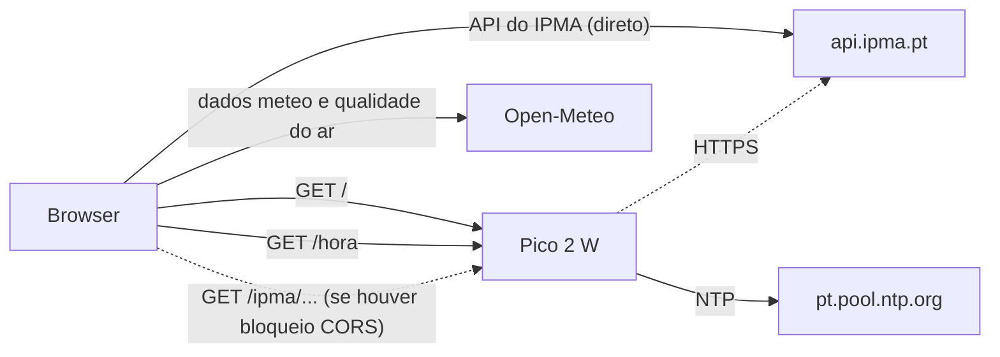

# 🐓 Galo Meteo

Estação meteorológica web para o **Raspberry Pi Pico 2 W**, escrita em **MicroPython**.

O Pico liga-se ao Wi-Fi, acerta a hora por NTP e serve uma página com o estado do tempo para qualquer distrito ou ilha de Portugal. Os dados vêm do [IPMA](https://www.ipma.pt/) e do [Open-Meteo](https://open-meteo.com/). Quem apresenta tudo é o **Galo Zé**, um galo de Barcelos que também faz de cata-vento. Muda de acessórios conforme o tempo e comenta a meteorologia com piadas que usam os valores reais.

> As piadas são do Galo Zé, os números não.

> [!WARNING]
> Este é um projeto pessoal e de hobby. Os dados apresentados **não têm qualquer garantia** e **não devem ser usados para tomar decisões**. Lê o **Aviso legal** no fim deste ficheiro.

---

## ✨ Funcionalidades

- **Relógio** sincronizado por NTP (`pt.pool.ntp.org`), na hora de Portugal continental e com mudança automática para a hora de verão.
- **Escolha do dia**: no topo há uma barra com "Agora" e os 4 dias seguintes. Também se pode tocar num cartão da previsão a 5 dias. Toda a página passa a mostrar esse dia: o Galo Zé, o fundo, o carimbo, os detalhes, as horas, o sol e a lua, o ar, a roupa, os avisos e as piadas. O dia escolhido é seguido pela data: depois da meia-noite, "Amanhã" passa a "Agora" e os outros dias recuam uma posição na barra.
- **Atualização automática**: os dados meteorológicos são atualizados a cada 5 minutos e a hora é acertada com o Pico a cada minuto, sem recarregar a página.
- **Mascote animada (SVG)**: o Galo Zé põe óculos de sol, guarda-chuva, gorro e cachecol, touca de dormir, etc., consoante o tempo. A seta do cata-vento aponta para a direção real do vento.
- **Fundo dinâmico**: muda de cor com o céu e a temperatura (calor, sol, ameno, nuvens, frio, chuva, neve, nevoeiro, trovoada, noite).
- **Avisos do IPMA** (amarelo, laranja, vermelho) para a zona e o dia escolhidos.
- **Em detalhe**: vento e rajadas, humidade, ponto de orvalho, pressão, visibilidade, nebulosidade, índice UV e precipitação. Em "Agora" mostra os valores atuais. Nos outros dias mostra os máximos, as médias e os totais previstos.
- **Hora a hora**: em "Agora", as próximas 24 h; nos outros dias, das 00h às 23h. Inclui um gráfico de temperatura e de probabilidade de chuva.
- **Sol e Lua**: nascer e pôr do sol, a posição do sol no céu, a duração do dia e a fase da lua.
- **Qualidade do ar e pólen**: índice europeu (AQI), PM2.5, PM10 e pólen de oliveira, gramíneas e bétula (CAMS via Open-Meteo). Nos outros dias mostra o máximo previsto.
- **O que vestir**: sugestões para as próximas 12 h ou, nos outros dias, das 8h às 22h.
- **Previsão a 5 dias** do IPMA.
- **Escolha do local**: todos os distritos e ilhas do IPMA. A escolha fica guardada no browser e, por omissão, o local é Lisboa.
- Funciona em telemóvel e computador, e respeita a opção `prefers-reduced-motion`.

## 🎭 Modos do Galo Zé

Os modos são calculados a partir da **sensação térmica**. Em **Agora** usa-se a sensação atual. Nos outros dias usa-se a **sensação máxima prevista**, e os detalhes mostram máximos, médias e totais desse dia.

| Carimbo       | Quando                       | Fundo    |
|---------------|------------------------------|----------|
| TROVÕES!      | trovoada                     | roxo     |
| NEVE?!        | neve                         | branco   |
| PINGA-PINGA   | chuva                        | azul     |
| NEVOEIRO      | nevoeiro                     | cinzento |
| VENTANIA      | rajadas ≥ 60 km/h            | (conforme a temperatura) |
| MODO GRELHA   | sensação ≥ 32°               | laranja (calor, a partir de 28°) |
| CALORZINHO    | 26° a 32°                    | laranja / amarelo |
| PERFEITO      | 20° a 26°                    | amarelo (sol) |
| AMENO         | 15° a 20°                    | verde    |
| FRESQUINHO    | 10° a 15°                    | verde    |
| FRIO          | 5° a 10°                     | azul gelo |
| GELADO        | < 5°                         | azul gelo |

Com o céu muito nublado e temperaturas entre 10° e 28°, o fundo fica cinzento-azulado (nuvens). De noite, em **Agora**, fica azul-escuro.

Para além do carimbo, o Galo Zé junta acessórios conforme o tempo:

| Acessório | Quando |
|---|---|
| óculos de sol | céu limpo e sensação ≥ 18° |
| gotas de suor | sensação ≥ 30° |
| gorro e cachecol | sensação ≤ 10° |
| guarda-chuva | chuva |
| flocos | neve |
| raio | trovoada |
| linhas de vento | rajadas ≥ 45 km/h |
| névoa | nevoeiro |
| touca e "zzz" | de noite, só em **Agora** |

Nos cartões da previsão a 5 dias do IPMA, cada dia tem uma etiqueta, escolhida por esta ordem: *Trovões à vista*, *Neve à vista*, *Dia de galochas*, *Talvez pingue*, *Ventania*, *Dia de nevoeiro*, *Modo forno*, *Cheira a praia*, *Geadinha*, *Sol sem desculpas*/*Perfeitinho*, *Ameno*, *Fresquinho* e *Frio de rachar*.

## 🧠 Como funciona

Para poupar RAM, o Pico faz o mínimo possível: guarda e envia ~54 KB de HTML, e é o browser que vai buscar quase todos os dados.



| Rota no Pico   | Descrição                                                                                                     |
|----------------|---------------------------------------------------------------------------------------------------------------|
| `/`            | Página da estação, enviada em blocos de 1 KB.                                                                 |
| `/hora`        | Hora local em JSON (`{"a":2026,"m":11,"d":11,"h":14,"mi":30,"s":5}`).                                          |
| `/ipma/<path>` | Ponte (proxy) para `https://api.ipma.pt/<path>`. Só aceita caminhos que comecem por `/open-data/`.            |

O browser tenta sempre chegar diretamente à API do IPMA. Só quando o pedido é bloqueado (por CORS ou por falta de rede) é que passa a usar o Pico como ponte. Nesse caso, o rodapé da página mostra "IPMA através do Pico".

Mudar de dia não gera pedidos novos. A página já tem a previsão dos 5 dias e só volta a desenhar as secções. Os pedidos às APIs repetem-se a cada 5 minutos, e o pedido `/hora` ao Pico a cada minuto.

## 🧰 Material necessário

- Raspberry Pi Pico 2 W (o Pico W original tem menos RAM e não foi testado com esta versão)
- Cabo micro-USB
- Rede Wi-Fi de 2,4 GHz com acesso à Internet

Não precisa de sensores: todos os dados vêm das APIs públicas.

## 🚀 Instalação

1. **Instalar o MicroPython** no Pico 2 W: descarregar o `.uf2` em <https://micropython.org/download/RPI_PICO2_W/>, ligar o Pico com o botão **BOOTSEL** carregado e copiar o ficheiro para a unidade que aparece.
2. **Abrir o projeto no VS Code** com a extensão [MicroPico](https://marketplace.visualstudio.com/items?itemName=paulober.pico-w-go). As extensões recomendadas já estão em `.vscode/extensions.json`.
3. **Configurar o Wi-Fi**: copiar o `secrets.example.py` para `secrets.py` e preencher os dados da rede (só 2,4 GHz):
   ```python
   SSID = "nome_da_rede"
   PASSWORD = "palavra_passe"
   ```
   O `secrets.py` está no `.gitignore` e nunca vai para o GitHub.
4. **Enviar o `secrets.py` e o `main.py` para o Pico**, com *MicroPico: Upload project to Pico* ou com o `mpremote`:
   ```bash
   mpremote cp secrets.py :secrets.py
   mpremote cp main.py :main.py
   mpremote reset
   ```
   Mesmo para correr o `main.py` com *Run current file*, o `secrets.py` tem de estar gravado no Pico, porque é lido de lá.
5. Na consola série aparece o endereço:
   ```
   A ligar ao Wi-Fi...
   Ligado! Abre http://192.168.1.42 no browser
   Hora sincronizada
   ```
6. Abrir esse endereço no browser. Em muitas redes, também funciona <http://meteo.local>.

Como o ficheiro se chama `main.py`, o Pico arranca a estação sozinho sempre que é ligado à corrente.

> 🔐 **Sobre a palavra-passe do Wi-Fi:** o `secrets.py` fica guardado no Pico em texto simples. Encriptá-lo não ajudaria, porque a chave para o decifrar teria de estar no mesmo sítio. Pela rede ninguém lhe chega, porque o servidor não dá acesso a ficheiros. Mas quem tiver o Pico na mão consegue lê-la. Por isso, o mais seguro é ligar o Pico à **rede de convidados ou a uma rede IoT** do router.

## ⚙️ Personalização

| O quê                      | Onde                                                                        |
|----------------------------|-----------------------------------------------------------------------------|
| Nome na rede (`meteo.local`) | `network.hostname("meteo")`                                               |
| Servidor NTP               | `ntptime.host`                                                              |
| Local por omissão          | `sel.value = pref.ler() \|\| "1110600"`: usar um `globalIdLocal` do IPMA    |
| Intervalo de atualização   | `setInterval(atualizarTempo, 5 * 60 * 1000)` (5 minutos)                   |
| Ressincronização NTP       | `time.time() - ultima_sync > 3600` (1 hora)                                 |
| Cores e tema               | Variáveis CSS em `:root` dentro da string `HTML`                            |
| Limiares dos modos         | Funções `ceuDe()` (fundo), `humor()` (carimbo), `modosGalo()` (acessórios) e `legendaDia()` (etiquetas dos 5 dias) |
| Espera pelo pedido HTTP    | `cliente.settimeout(2)` no ciclo do servidor (2 segundos)                   |

## 📡 Fontes de dados

- **[IPMA](https://api.ipma.pt/)**: lista de locais, previsão a 5 dias, tipos de tempo e avisos meteorológicos.
- **[Open-Meteo Forecast API](https://open-meteo.com/en/docs)**: condições atuais, previsão hora a hora, nascer e pôr do sol, índice UV.
- **[Open-Meteo Air Quality API](https://open-meteo.com/en/docs/air-quality-api)**: AQI europeu, partículas e pólen (dados CAMS).
- **Google Fonts**: as fontes Fredoka e Nunito.

Nenhuma destas APIs precisa de chave.

## 📝 Notas e limitações

- **TLS sem verificação**: o proxy do IPMA não verifica o certificado do servidor, porque o Pico não tem autoridades de certificação (CAs) carregadas. É aceitável para dados meteorológicos públicos.
- **Servidor simples**: atende um pedido de cada vez, o que chega perfeitamente para uso doméstico. Os browsers abrem ligações "de reserva" que muitas vezes não enviam nada. O Pico espera no máximo 2 s pelo pedido e fecha essas ligações em silêncio, para não atrasar os pedidos verdadeiros.
- **Previsão dos dias seguintes**: os modos e os detalhes de cada dia são resumos (máximos, médias e totais) da previsão hora a hora do Open-Meteo. Os avisos do IPMA só existem para cerca de 3 dias.
- **Fuso horário**: a hora servida em `/hora` é a de Portugal continental. Nos Açores, o relógio da página fica uma hora adiantado, mas os dados meteorológicos continuam certos.
- **Memória**: o HTML é guardado como `bytes` e enviado em blocos de 1 KB. Depois de cada pedido é chamado o `gc.collect()`.

## 🛠️ Problemas comuns

| Sintoma na consola | O que fazer |
|---|---|
| `ImportError: no module named 'secrets'` | O `secrets.py` não está gravado no Pico. Envia-o com *Upload file to Pico*. |
| Fica em `A ligar ao Wi-Fi...` | Confirma o nome e a palavra-passe no `secrets.py` e que a rede é de 2,4 GHz. |
| `OSError: [Errno 98] EADDRINUSE` | A porta 80 ainda está ocupada pela execução anterior. Faz um soft reset (`Ctrl+D` no REPL) e corre de novo. |
| `Falha NTP: ...` | A hora fica por acertar até à tentativa seguinte (1 hora depois). Normalmente é uma falha de rede passageira. |
| `Erro: ...` | Um erro real ao responder a um pedido, por exemplo na ponte para o IPMA. As ligações vazias do browser não geram este erro. |

## 📁 Estrutura

```
.
├── main.py                 # servidor, NTP, proxy IPMA e a página completa (HTML/CSS/JS)
├── secrets.example.py      # modelo das credenciais do Wi-Fi
├── secrets.py              # as tuas credenciais (não vai para o git)
├── .gitignore              # deixa o secrets.py de fora
├── LICENSE                 # licença MIT
├── .micropico              # marca a pasta como projeto MicroPico
└── .vscode/                # definições e extensões recomendadas do VS Code
```

## ⚖️ Aviso legal

O Galo Meteo é um **projeto pessoal, educativo e sem fins comerciais**, feito para aprender e para usar em casa.

- **Dados sem garantia.** A informação vem de serviços de terceiros (IPMA, Open-Meteo/CAMS) e é processada e apresentada por este software de forma simplificada. Pode estar incompleta, desatualizada, mal interpretada ou simplesmente errada, por falhas de rede, alterações nas APIs, erros no código ou na hora do dispositivo. Não existe qualquer garantia de exatidão, de disponibilidade ou de atualidade.
- **Não usar em contexto profissional ou crítico.** Não uses este projeto em atividades profissionais nem em decisões que afetem a segurança de pessoas ou bens. Isto inclui, entre outras, aviação, navegação, atividades de montanha ou no mar, agricultura, proteção civil, gestão de eventos e saúde.
- **Fontes oficiais.** Para informação meteorológica fiável, sobretudo avisos e alertas, consulta sempre o [IPMA](https://www.ipma.pt/) e as indicações da [Proteção Civil](https://www.prociv.gov.pt/).
- **Sem afiliação.** Este projeto não tem qualquer ligação ao IPMA, ao Open-Meteo, ao Copernicus/CAMS nem à Raspberry Pi Ltd., e não é apoiado por nenhuma destas entidades. Os dados são usados de acordo com os termos de cada serviço.
- **Piadas.** As frases do Galo Zé são humorísticas e não substituem nenhuma recomendação oficial.

A utilização do projeto é da inteira responsabilidade de quem o usa. Os autores não respondem por danos ou prejuízos que resultem do seu uso, como estabelece a licença.

## 📄 Licença

Distribuído sob a licença **MIT**. Ver o ficheiro [`LICENSE`](LICENSE).

---

Feito com ☕ e um Raspberry Pi Pico 2 W 🇵🇹
